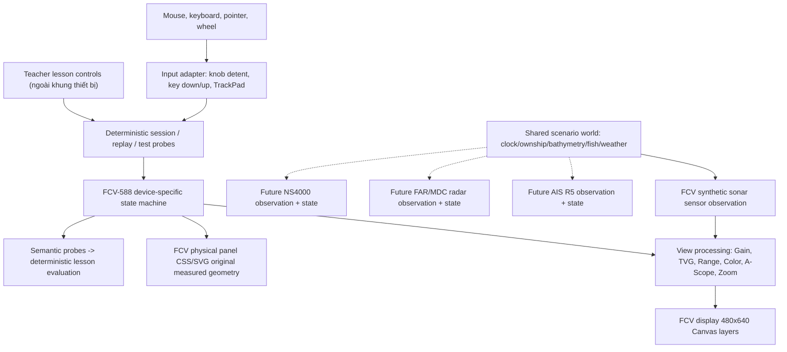

# Brainstorm + tư vấn kỹ thuật: tái hiện FCV-588 đầy đủ thao tác như máy thật

**Ngày:** 13/10/2026 (GMT+7) · **Workspace:** C:\Work\MoPhongMayTrenTau

**Phạm vi:** Nghiên cứu, audit và đề xuất thiết kế, **chưa viết bản mô phỏng hoàn chỉnh**. Các file PDF hãng tải về chỉ nằm tại sources/manuals với tình trạng quyền REVIEW_REQUIRED; không lấy hình/logo/đoạn tài liệu từ đó để phát hành giao diện.

**Các chuẩn thực thi sau review:** [Giao thức nghiệm thu thống nhất](FCV588_FIDELITY_ACCEPTANCE_PROTOCOL.md), [kiểm kê toàn bộ nguồn manual và trạng thái HOLD](../../sources/manuals/ARCHIVE_COVERAGE.json), và [kế hoạch F1 có 7 pha](../../plans/261013-1319-fcv588-full-fidelity-simulator/plan.md). Các ngưỡng thử nghiệm ở giao thức là tiêu chí *nội bộ đề xuất*, không phải thông số từ FURUNO.

**Status count trung thực:** [Feature Register dự thảo](FCV588_FEATURE_REGISTER_DRAFT.json) có **64 dòng thao tác FCV** (11 SIMULATED_ONLY, 53 OPEN, 0 VERIFIED_IMPLEMENTED), cộng **D15 là một yêu cầu bảng giảng viên** (platformQaStatus SIMULATED_ONLY). Không tính D15 như chức năng thuộc phần cứng FURUNO và không chứng nhận 11 dòng FCV đã giống máy thật.

**Phương pháp và giới hạn skill:** Đã đọc bản cài đặt thực của ak-brainstorm v2.8.2 (bao gồm các reference --ultra, --advice), ak-research, ak-pdf, ak-docs-seeker. Tên cờ do người dùng nói `--ultrathink` không tồn tại trong tham số thực; chế độ hợp lệ là `--ultra`. Chế độ ultra đòi **5 ứng viên read-only trong một đợt song song + 1 verifier Kongming**; runtime này chỉ cho tối đa 2 worker CoS và không cung cấp tác nhân `kongming` có thể nhắm đích. Vì vậy **không thể xác nhận đã chạy --ultra/--advice chuyên biệt**. Đã nhận phản biện kiến trúc/nguồn từ worker read-only và áp dụng phương pháp tư vấn chuyên sâu bản địa; không tự ghi receipt ultra giả.

## 1. Kết luận

**Khuyến nghị:** nâng nền F0 đang có thành một **device-specific digital twin về thao tác** cho **FCV-588 theo đúng cấu hình firmware và đầu dò của máy lớp học**, không biến nó thành bản sao sonar đo sâu có giá trị dẫn đường. Mặt máy có kích thước/tọa độ cố định theo tỷ lệ đo thực; phím, núm và những hiệu ứng chuyển menu được viết bằng state machine độc lập; màn hình phản chiếu từ view model được sinh bởi cùng một bộ dữ liệu giả lập xác định được. Giữ Simulation Core dùng chung cho radar/AIS/ECDIS trong tương lai, nhưng **không chuẩn hóa cưỡng bức các menu, phím hoặc thuật toán hiển thị khác loại máy**.

Không thể hứa “giống hệt 100%” ngay từ PDF. Chưa có ảnh mặt máy đủ quyền sử dụng, chưa có máy thật làm baseline, chưa biết firmware Starter/Booter/Main, loại đầu dò, Tankenmaru, các giá trị đã lưu và cấu hình GPS/temp/speed. Mọi tính năng thuộc lớp phụ thuộc phải phản ánh **có/không** theo máy đích, không bật toàn bộ một cách giả tạo. F0 đạt logic kỹ thuật từng phần, không đủ để học viên dùng như tài liệu thao tác đã nghiệm thu.

## 2. Hợp đồng sản phẩm (brainstorm contract)

| Trường | Nội dung đã xác nhận / giả định được đánh dấu |
| --- | --- |
| **Outcome** | Học viên nhìn mặt máy FCV-588 trên Windows, sử dụng phím/TrackPad/núm tương đương, nhận được phản hồi màn hình/cảnh báo, luyện mọi luồng chức năng được manual hỗ trợ trên cấu hình máy chọn làm chuẩn. |
| **Ràng buộc** | Đúng model+firmware+transducer; bản quyền ảnh/biểu tượng; không dùng để điều hướng hay phát tín hiệu thực; không kết nối máy vận hành; chạy được trên phòng máy Windows; sử dụng lại F0 đúng ranh giới. |
| **Non-goals giai đoạn FCV** | Không mô phỏng vật lý thủy âm đạt chuẩn khoa học, không chép ROM/firmware nhà sản xuất, không phát/nhận tín hiệu đầu dò, không xây 3D bridge, không tích hợp AIS R5 chưa xác định variant, không tự triển khai online grading chống gian lận. |
| **Nghiệm thu sản phẩm** | Đủ toàn bộ 65 mục kiểm kê trong phạm vi option thật; 100% thao tác mục tiêu được đánh dấu VALIDATED hoặc NOT_APPLICABLE_WITH_HARDWARE_EVIDENCE, không có UNKNOWN/placeholder ở bài huấn luyện được công bố; các chuỗi phím được chuyên gia xác nhận. |
| **Nghiệm thu kỹ thuật** | TDD unit/integration + browser E2E + replay; 0 lỗi nghiêm trọng; mọi session tái lập; bật/tắt/đổi mode/cancel/power persistence đúng mô hình đã đo; render không sửa world sensor truth; không đưa manuals vào output phát hành. |
| **Giả định còn mở** | Mẫu máy/firmware thật trong lớp, số màn hình/độ phân giải Windows, mức cần chính xác ảnh pixel, phạm vi phân phối trường học, quyền ảnh/video, có thể mời chuyên gia FCV-588 thẩm định hay không. |

**Yêu cầu “đầy đủ”:** bao phủ mọi chức năng vận hành nhìn thấy trong Operator's Manual Ch.1–3, bao gồm trường hợp bị khóa bởi cấu hình đầu dò/ngoại vi. Không đồng nghĩa mọi tùy chọn đều được phép thực hiện trên một máy.

## 3. Chứng cứ kiểm toán

**Đã có trong workspace:** F0 sử dụng native Node ES Modules, browser HTML/CSS/Canvas, tách world/sensor/device, replay envelope và input press/cancel. Hồ sơ F0 báo 34/34 test qua kiểm thử trước; không thể suy ra 34/34 thao tác giống máy thật. Màn hình hiện 480×640, phím ENTER tách TrackPad và trợ xoay +/- nằm ngoài mặt máy. Song vẫn còn menu placeholder, ảnh NAV/ZOOM giả, hệ thống cảnh báo, waypoint, calibration, diagnostics chưa triển khai.

**Đã lấy tài liệu tham chiếu:** FURUNO FCV-628/588 OME-23890-E 2025, 88 trang, SHA-256 trong sources/manuals/MANIFEST.json. FURUNO sản phẩm xác nhận tỷ lệ dọc 480×640 và các nhóm chức năng sonar; manual cho biết Ch.1 Operation, Ch.2 System, Ch.3 Maintenance/Troubleshooting. Thực tế bản UI phụ thuộc v1.05 hay v2.01 hoặc phiên bản Main khác: không được tự “nâng lên mới nhất”.

**Sai khác F0 cần ưu tiên sửa theo audit độc lập manual:** 

1. MODE đang chuyển ngay không hiện cửa sổ chọn/timer khoảng 6 s; còn khả năng MODE bỏ qua startup sau 3–5 s chưa mô phỏng.
2. POWER giữ dài đổi trạng thái trực tiếp, chưa có màn đếm ngược trước khi tắt.
3. BRILL chưa tự đóng sau bất động và chưa cycle độ sáng liên tục khi bấm lại.
4. RANGE bấm lặp trong Manual chưa theo vòng tám cấp như máy thật; preset hiện cố định thử nghiệm.
5. VRM F0 đặt readout góc màn, máy thật đọc độ sâu sát vạch VRM; bước 1 m F0 chỉ minh họa.
6. Demo hiện là bộ dữ liệu giả lập mặc định, chưa có System→Demo On/Off và chỉ báo DEMO trong khu vực quy định.
7. FUNC giữ 650 ms là giả định phát triển, manual chưa xác nhận ngưỡng; cấm dùng nó để chấm bài thật.
8. Hệ menu chính/phím thoát/tuỳ chọn và màn hình NAV/Zoom chưa có đầy đủ; mọi ảnh “giống hệt” hiện là tuyên bố chưa có chứng cứ.

**Nguồn:** [FURUNO FCV-588 hãng](https://www.furuno.com/en/products/fishfinder/fcv-588/index.html), [FURUNO FCV588 support](https://www.furunousa.com/en/support/FCV588), [manual OME-23890-E](https://www.furunousa.com/-/media/sites/furuno/document_library/documents/manuals/public_manuals/fcv628_fcv588_operators_manual.pdf). Không đưa ảnh tài liệu gốc vào file báo cáo này.

## 4. Ba phương án kỹ thuật (trade-offs)

| Phương án | Cách thực hiện | Giả định quyết định | Điểm gãy sớm nhất | Đánh giá |
| --- | --- | --- | --- | --- |
| **A. Giao diện ảnh màn hình + hotspot** | Chụp/cắt giao diện theo từng ảnh, gắn vùng click và chuyển ảnh/nhánh | Chỉ có vài chuỗi thao tác tuyến tính; có quyền sao chép ảnh | Sự kiện Gain/Range làm dữ liệu sonar/alarms biến đổi đồng thời, số tổ hợp tăng vượt số ảnh chụp; rủi ro bản quyền | Chỉ phù hợp storyboard nội bộ có phép; **không đủ full chức năng** |
| **B. Device state machine + layout chuẩn + Canvas renderer + scenario core** | Giữ F0 lõi, cấu hình tĩnh versioned, bộ reducer theo menu, renderer đa lớp, dữ liệu sonar giả lập kiểm soát được | Có nguồn hành vi màn hình/phím đủ tốt và người kiểm chứng đối chiếu | Không có máy/ảnh được phép sử dụng, thiếu firmware thực; có thể chứng minh chức năng phần mềm nhưng chưa đạt identical | **CHỌN; có thể triển khai từng phần, chi phí bỏ thay thấp** |
| **C. Reverse engineer firmware/giả lập ROM hoặc mua emulator chính hãng** | Chạy firmware giả lập hay tích hợp sản phẩm vendor thương mại | Có firmware/license/API hợp lệ và tài liệu nội bộ | IP, không có source/license, hardware dependency, chi phí không kiểm soát | Không khuyến nghị ở hiện trạng |

**Better approaches:** phương án B tốt hơn A nếu mục tiêu “đủ chức năng” vì trạng thái được định nghĩa bằng hành vi và có thể test/replay, không phải nhân số màn hình tĩnh. Một nâng cấp hữu ích so với đề xuất “một màn hình dùng chung” ban đầu là **sự thật thế giới chung, trạng thái màn hình riêng theo model và firmware**; chi phí chuyển đổi chính là cần đo bộ máy thật và viết reducer/menu model chi tiết.

## 5. Kiến trúc mục tiêu tối thiểu



Đây là sơ đồ **đề xuất**, không phải các phần mềm đã hoàn thành. Không sử dụng NMEA TX/WebSerial/WebUSB/WebSocket hoặc đầu dò thực trong phiên bản đào tạo ban đầu. Nguồn GPS/AIS/nhiệt độ/tốc độ giả lập là typed observation, nguồn tín hiệu chưa có phải hiển thị trạng thái không có dữ liệu, không invent vị trí tàu.

### Tách bốn lớp để tránh sai khi mở rộng

**World (truth):** độ sâu, đáy, mục tiêu, ownship, môi trường, scenario seed và clock; mỗi thiết bị chỉ đọc; không cho núm Gain/Range sửa World.

**Sensor observation:** khung dữ liệu cảm biến giả lập 50/200kHz chứa echo raw + nhiệt độ/GPS nếu scenario khai báo; ghi version/seed; riêng mỗi cảm biến có stream PRNG riêng. Đây không phải số liệu sonar đo thực.

**FCV device state:** power, boot/countdown, menu stack/cursor, staging/commit/cancel, mode/zoom, range preset, gain/offset, per-channel settings, units, depth marker, alarms/ack, waypoint CRUD, Demo, diagnostics, firmware/transducer-specific feature guards, persistence. Reducer thuần và có unit test.

**View/UI:** mặt máy nguyên bản tự vẽ theo kích thước/tọa độ thu thập hợp pháp; Canvas chia vùng hồi âm, header/status, modal/menu, overlay/alarm/VRM. Điều khiển trợ xoay dành cho PC nằm ngoài mặt máy, không đánh lừa học viên về phím thật. Tạo screenshot regression chỉ từ tài sản được phép sử dụng.

### Contract tối thiểu

```ts
type ProfileKey = {
  manufacturer: "FURUNO";
  model: "FCV-588";
  firmware: { starter: string; booter: string; main: string };
  transducer: string | null;
  tankenmaru: boolean | "unknown";
  locale: string;
  manualEvidenceId: string;
  manualSha256: string;
  profileRevision: string;
};

type ControlEvent =
  | { device: string; kind: "press"; control: string; seq: number }
  | { device: string; kind: "hold"; control: string; durationMs: number; seq: number }
  | { device: string; kind: "rotate"; control: string; detents: number; seq: number }
  | { device: string; kind: "trackpad"; direction: "up" | "down" | "left" | "right"; seq: number };
```

Đây là **hợp đồng tương lai minh họa**, không thay thế giao diện InputEvent đang chạy của F0. Các schema thực phải gắn `simTick`, `coreVersion`, `scenarioHash`, `deviceProfileHash`, `prngVersion` và giữ event log replay theo đúng thứ tự. Không áp đặt menu bằng một JSON scripting DSL tổng quát.

## 6. Chiến lược “đầy đủ chức năng” theo tầng

Tham chiếu ma trận [65 yêu cầu](FCV588_FULL_FUNCTION_INVENTORY_2026-10-13.md). Tách tám bộ test chứ không đợi hoàn thiện toàn bộ trước khi kiểm:

| Dòng công việc | Mục tiêu demo nhỏ nhất | Điều kiện lên mức VERIFIED |
| --- | --- | --- |
| **Panel fidelity** | Khung 480×640 + các phím đúng bố cục và layout tỉ lệ | So với ảnh chụp chính diện có quyền + đo kích thước/nhãn; người dùng máy xác nhận |
| **Power/BRILL/MODE** | Nguồn boot/countdown, Brightness, MODE selector 6s | Các bước, hold, timeout, trạng thái boot và persistence đúng firmware |
| **Menu tree & control** | 5 main menu và các lớp menu con; staged commit | Test mỗi đường menu, Back/ESC, timeout/reopen, lỗi option |
| **Sonar rendering** | LF/HF, DUAL, BL/BZ/MZ, A-Scope, Range/Gain/TVG | UI phản ứng nhất quán trên bathymetry/fish/noise fixture; screenshot đối chiếu |
| **Advanced transducer functions** | ACCU-FISH, Bottom Disc., RezBoost | Có capability matrix theo transducer/firmware, disabled không thể bật, đúng tình huống giả lập |
| **Alarms** | Fish/bottom/temp/speed/arrival/bottom type | Cause→alarm→ack→clear đúng trạng thái; multi-alarm không ghi đè |
| **NAV/Waypoint/System** | NAV1/NAV2, CRUD waypoint, units/calib/demo | Missing-data, persistence/restore, wrong-order, option gates đúng |
| **Diagnostics/Instructor** | Battery alert/LCD Test/restore + script bài học | Không chạm phần cứng, replay và kiểm tra semantic, teach flow đầy đủ |

**Một chức năng không có tín hiệu mô phỏng hợp lý** thì phải biểu thị “SIMULATED/UNAVAILABLE” trong tài liệu giảng viên, không âm thầm giả vờ đã đo được đáy hoặc ước lượng kích thước cá đúng vật lý.

## 7. Kiểm thử chất lượng & fidelity gates

**Acceptance hướng phần mềm:** 100% các trang menu được ghi nhận trong manual cho đúng firmware được liệt kê trong tree và có test reachable; 100% hành vi chính do nhà sản xuất mô tả có unit+browser test; ở mỗi feature phải có success, invalid input, Back/ESC, power/restart, missing option/data, persistence khi phù hợp; không có placeholder nào xuất hiện trong những bài học đã được phát hành. Các bài kiểm ở những điểm sát mép (GAIN min/max, RANGE 1/8, Alarm muted/cleared, data timeout, chức năng tắt theo transducer) phải có fixture và oracle độc lập.

**Fidelity theo ảnh/thao tác:** trên hardware target, ghi vị trí/tỉ lệ màn hình/khung mặt trước, log 30 lần click/rotate/hold thử nghiệm cho mỗi loại đầu vào; mục tiêu kỹ thuật đề xuất là **không mất/nhân đôi/đảo chiều sự kiện** trong đợt kiểm thủ công có giám sát. Tolerance vị trí đề xuất ±2% khung (mục tiêu nội bộ chưa có phép đo, không phải chuẩn FURUNO), screen-state screenshot hợp pháp tại 100%, 125% và 150% Windows scaling. Đặt bộ diff và vùng ngoại lệ cho animation, không lấy pixel snapshot thay thế test semantic.

**Gate thực tế:** trước khi dạy thật, chuyên gia thao tác FCV-588 độc lập chạy mọi bài cùng phiên bản firmware và ký xác nhận từng chức năng; điểm chưa rõ = HOLD, không tính 100% coverage. Không gắn nhãn OEM-certified khi không có chứng nhận.

## 8. Lộ trình và khối lượng sơ bộ

| Pha | Kết quả review được | Ước lượng 1 dev kinh nghiệm (tùy dữ liệu ảnh/máy thật) |
| --- | --- | --- |
| P00: quyền, ảnh, firmware, manual baseline | Equipment Evidence Pack, quyền tham khảo & asset, version lock | 1–3 tuần + thời gian chờ bên thứ ba |
| P01: panel, input, power/mode/BRILL/range/gain | Chuỗi thao tác T01–T06 đã đối chiếu | 3–6 tuần |
| P02: cây menu đầy đủ & System config | Chọn lưu/hủy, preset, language/units, option gate | 4–8 tuần |
| P03: màn hình sonar/advanced mode | LF/HF/Zoom, xử lý ảnh phù hợp điều kiện, ACCU-FISH/Bottom Disc/RezBoost giả lập | 5–10 tuần |
| P04: alarms, waypoint, nav data, Demo, diagnostics | Test kịch bản thành công/lỗi, file fixture và tích hợp | 4–8 tuần |
| P05: toàn bộ regression, visual, hardware/instructor sign-off | Chứng cứ cho các trạng thái VALIDATED/NOT_APPLICABLE | 3–6 tuần |

**Tổng tham khảo:** **20–41 tuần công** cho một người phát triển có kinh nghiệm sau khi có đầy đủ dữ liệu quyền và thiết bị; không phải cam kết. Nếu cần mô hình sóng âm/thuật toán proprietary thực sự hay chưa có quyền/phần cứng, dự án có thể vượt xa dự toán. Hệ thống chung sẽ tiêu tốn thêm khi tích hợp AIS/radar thực tế, nhưng không cần đợi những module đó mới hoàn thiện FCV.

## 9. Rủi ro và quyết định cần người dùng xác nhận

| Mức | Rủi ro | Phương án giảm thiểu |
| --- | --- | --- |
| BLOCKER | Cấu hình máy/firmware thực chưa biết, có thể dạy sai phím và menu | Ảnh mặt sau/Diagnostics, firmware, đầu dò và những option thực; khóa target |
| BLOCKER | Ảnh/screenshots/manual được bảo hộ, hạn chế sử dụng/AI | Xin quyền thích hợp; tự đo và thiết kế lại thành asset nguyên bản, raw PDF restricted |
| HIGH | F0 bị hiểu nhầm là giống máy thật | Ghi “TRAINING MOCK-UP / NOT VALIDATED”; không chấm điểm các chức năng chưa được duyệt |
| HIGH | Dự án bị trộn logic menu radar/AIS/sonar vào một mega reducer | Một reducer riêng theo device, world/sensor typed boundary chung |
| HIGH | Mỗi thay đổi overlay làm replay và lesson sai | Event-sourced log, versioned fixture, unit/projection/integration snapshots |
| HIGH | Cố gắng mô phỏng chức năng cảm biến proprietary vượt quá dữ liệu hiện có | Xây case scripted demo rõ nguồn, kiểm tra điều kiện thay vì khẳng định thuật toán OEM |
| MEDIUM | Render Canvas 480×640 bị sai scale/độ mượt/tốc độ tại Windows DPI | đo/tối ưu ở viewport mục tiêu, visual diff từng zoom, DOM keyboard a11y |
| MEDIUM | Sự kiện bấm giữ, núm, TrackPad ngoài tốc độ mô phỏng | Record press duration/detent semantic rồi replay; kiểm tra focus, capture, repeat |

## 10. Các bước tiếp theo và hợp đồng bàn giao

**Bước 1 (làm ngay sau nghiên cứu):** khóa F1-00 bằng chứng thực tế và quyền. Đây là bước chặn tốt nhất để không viết hàng tháng một giao diện menu sai model. Song song có thể hoàn thiện framework kiểm thử/khả năng versioning không đụng tư liệu hãng.

**Bước 2:** tạo `FCV588_OPERATIONS_CONTRACT.json` từ ma trận 65 mục chỉ sau khi xác minh quyền xử lý; mỗi feature gồm `sourceId/page`, `firmwareGuard`, `transducerGuard`, `initialState`, `inputSequence`, `expectedView`, `cancel`, `persistence`, `graderProbe`. Lưu ý JSON chỉ là spec/tư liệu, logic thực nằm trong reducer riêng.

**Bước 3:** hiện thực test-first theo từng nhóm P01–P05, luôn có browser/manual device comparison, tránh làm GUI “đẹp như ảnh” nhưng bấm sai.

**Bước 4:** sau FCV VERIFIED, dùng cùng kịch bản chạy cùng FCV + một **stub AIS R5/radar không giả mạo giao diện máy** để xác nhận world stream/clock độc lập, rồi mới thiết kế R5 thật khi rõ SUPREME/SOLID.

### Done means (kiểm tra được)

- FCV-588 cụ thể được nhận diện bằng phiên bản Starter/Booter/Main, loại đầu dò, option, cấu hình đơn vị; manual/evidence/rights có revision, SHA và người chịu trách nhiệm xác nhận.
- 65 mục kiểm kê có kết quả; tất cả mục áp dụng cho cấu hình target đều được triển khai, có test và được người vận hành xác nhận; mục không áp dụng có căn cứ.
- Bố cục/nhãn phím, timing và toàn bộ màn hình chức năng được đối chiếu với ảnh/video hợp pháp; không còn placeholder trong bài học đã duyệt.
- Test tại Windows thật và replay deterministic GREEN; không có đường xuất dữ liệu đến thiết bị vận hành; không đưa manual/ảnh hãng vào bản phát hành nếu chưa có quyền.

### Handoff brief

```text
Objective: Hoàn thiện FCV-588 operator-interface training simulator full fidelity theo
 một unit classroom đã xác minh, giữ shared simulation core cho các thiết bị sau.
Done means: 65 inventory items classified; every supported operator flow tested,
 screenshot/gesture/firmware evidence signed by operator, replay regression all
 green, no placeholder among published lessons, permissions recorded.
Out of scope: Proprietary ROM/sonar physics, real equipment I/O, multiuser service,
 3D bridge, generic AIS R5 UI before variant identification.
Constraints: Workspace C:\Work\MoPhongMayTrenTau; exact firmware/transducer;
 no vendor artwork copied without permission; training-only isolated; preserve F0.
Stop and ask only if: Hardware identity/evidence or rights remain unavailable,
 an irreversible/destructive action would be required, or a change crosses scope.
```

## 11. Nguồn và hạn chế

1. [FURUNO FCV-588 product, specs & manual index](https://www.furuno.com/en/products/fishfinder/fcv-588/index.html) — thông số màn hình, nhóm chức năng và URL tài liệu hãng.
2. [FCV628/588 Operator's Manual hãng](https://www.furunousa.com/-/media/sites/furuno/document_library/documents/manuals/public_manuals/fcv628_fcv588_operators_manual.pdf) — bản local OME-23890-E 2025, nguồn chỉ tham khảo hạn chế; trang in từ 1 đến 33 cho Ch.1–3.
3. [FCV-588 FURUNO support/software history](https://www.furunousa.com/en/support/FCV588) — chỉ số thay đổi firmware (v1.05/v2.01) và model.
4. [FURUNO Terms](https://www.furunousa.com/en/terms_of_use) — giới hạn sử dụng ảnh/tài liệu, không có giấy phép OEM từ việc tải công khai.
5. [MANIFEST tài liệu nội bộ](../../sources/manuals/MANIFEST.json), [receipt](../../sources/manuals/VERIFICATION_RECEIPT.json).
6. [65 feature inventory](FCV588_FULL_FUNCTION_INVENTORY_2026-10-13.md) và [F0 Audit](../F0-AUDIT.md).

**Unverified cuối cùng:** phiên bản firmware và thiết bị thật; hình ảnh/độ chuẩn pixel; mọi hành vi chỉ được nói đúng khi đã đo/đối chiếu; chức năng proprietary có thể phải dùng tình huống demo giả rõ nhãn; quyền tái sử dụng manual/screenshots. Không có chứng cứ nào cho phép đánh dấu sản phẩm “giống hệt hoàn toàn” ở giai đoạn này.
